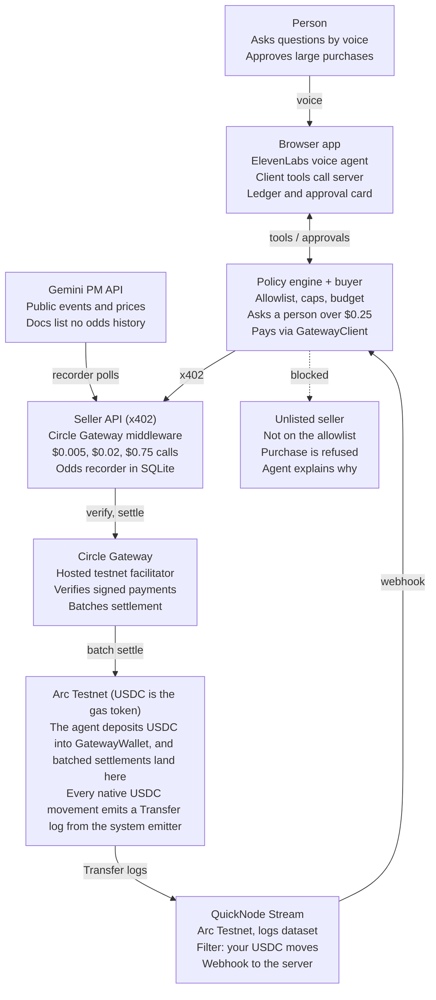

<!-- Source: https://claude.ai/artifact/ENJB57yrVYvbu7GSWQYciX (doc rev 14), exported 2026-11-20. The embedded architecture figure is transcribed as Mermaid below. -->

# UBC 2026 Hackathon: Recommendation & Build Plan

Nov 20, 2026 · @Pratyush Sawant

## Bottom line

Build **Allowance**: a voice-driven AI agent that pays for data per request in USDC on Arc, within spending rules a person sets. Enter **Agentic Payments and AI**, pick **Best use of Arc** as the chain award, and opt into the **Gemini Prediction Markets** and **ElevenLabs** bounties. Add **QuickNode Streams** only if the Stream ships.

The demo has four moments. The agent pays $0.005 on its own, asks before a $0.75 purchase, refuses a seller that isn't on the allowlist, and logs every cent in a live ledger. These prizes add up to $6,000 in cash plus ElevenLabs credits, and every entry also competes for the $2,500 overall prize.

Three constraints shape the rest of this plan:

- **Deadline:** submissions close today, Fri Nov 20, at 12:00 PM CST. Aim to submit by 11:00 AM.
- **In person:** every prize requires being at the final presentations at UT Austin on Sat Nov 21.
- **Fresh code:** everything you submit must be written during the event. Use sponsor SDKs as dependencies, but don't fork their sample apps.

## Rules that constrain the build

The rules that bind are a noon deadline today, being there in person on Saturday, and code written only during the event. Every row below was checked against the [hacker guide](https://docs.google.com/document/d/1QaySCo7u3VxMVNdk3C5Ab3ewc2E46AuLntti-Uzx5EY/), the [Devpost overview](https://ubc-hackathon-2026.devpost.com/) and the [Devpost rules](https://ubc-hackathon-2026.devpost.com/rules).

| Rule | What it says | Source |
| --- | --- | --- |
| Deadline | Submissions close Fri Nov 20 at 12:00 PM CST. Finalists are told by 11:59 PM CST the same day. | Devpost overview |
| In person | You must be present at the final presentations to win any prize, including bounties. Judging and pitches happen Sat Nov 21 at the UBC closing ceremony at UT Austin. | Devpost rules, guide |
| Fresh code | All code must be created during the event. Pre-existing projects, old codebases and work from before Nov 13 are not allowed. | Devpost rules |
| Team | 1 to 4 people, and solo is allowed. Open to students, independent builders and community members. | Devpost rules |
| AI tools | Allowed, as long as the builders remain the primary creators. | Devpost rules |
| Prize structure | Pick exactly one main track and at most one chain award (Solana or Arc, never both). Enter any bounties you qualify for. All other prizes stack. | Guide |
| Who judges | A UBC rep picks each Track Winner. Solana and Arc reps pick their chain awards. Each sponsor and a UBC rep pick that sponsor's bounty. | Guide |
| Finals | Up to 13 teams pitch live, with 4 minutes to present and 2 for Q&A. The 1st-place Gemini bounty team is among them. | Guide |
| What to submit | Name, description and team. Track, chain award and bounties. Five written answers and the tools used. A public GitHub repo with setup steps, a working demo or deployed app, a 2–3 minute video on Drive or YouTube, a README with the architecture, and any track-specific items. | Guide |
| Judging criteria | Technical Execution, Product & UX, Innovation, Impact & Potential, and Demo. No weights are published. | Devpost overview |

## Options compared

Option A can compete for the most cash, and every bounty it enters is part of how the product works. The other options either drop the Gemini bounty, which is the largest, or leave the chain award weak.

| Option | Track + chain award | Bounties that genuinely fit | Cash it can compete for | Build risk in \~8 hours | Demo |
| --- | --- | --- | --- | --- | --- |
| **A. Allowance:** a voice agent that buys data per request within spending rules (recommended) | Agentic Payments + Arc | Gemini, ElevenLabs, QuickNode | $2,000 + $1,000 + up to $2,500 + $500 = $6,000 | Medium: four integrations, each with an official SDK. Voice and the Stream can be cut. | Strong: auto-pay, approval and a blocked purchase all happen live |
| A2. The same concept on Solana devnet | Agentic Payments + Solana | Gemini, ElevenLabs; QuickNode is a weaker fit | $2,000 + $1,500 + up to $2,500 + $500 = $6,500 | Medium-high: no Nanopayments, and Solana Devnet Streams offer only the Block and Logs-with-Programs datasets ([QuickNode](https://www.quicknode.com/docs/streams/supported-chains)) | Strong |
| B. A voice-first USDC wallet ("send $5 to Sam") | Consumer Apps + Arc | ElevenLabs, QuickNode | $2,000 + $1,000 + $500 = $3,500 | Medium: onboarding needs polish, and voice-started payments invite security questions | Good, but a common hackathon idea |
| C. A prediction-market tracker with spoken briefings | Consumer Apps; chain award a stretch | Gemini, ElevenLabs | $2,000 + up to $2,500 = $4,500 | Low, but the blockchain part would be bolted on | Fair |
| D. A pay-per-call API storefront for agents | Agentic Payments + Arc | QuickNode | $2,000 + $1,000 + $500 = $3,500 | Low to medium | Weak: close to [Circle's own sample app](https://github.com/circlefin/arc-nanopayments) |

Grok Bot is left out of every option. It is a beta product of agents that run on their own cloud computer ([xAI](https://x.ai/news/introducing-grok-bot)), and the bounty requires it to be central to the project. Forcing it in would cost cohesion for a prize of one keyboard per member.

## Recommendation: Allowance

Allowance is an AI agent with a USDC budget. It buys the data it needs per request, within rules a person sets, and talks through each purchase out loud. Its first data source is Gemini Prediction Markets, so it can say what markets expect about a real-world event and how that changed today. The spending layer itself is generic: it works with any x402 API, and prediction markets are just the first catalog.

How a request flows:

1. The user asks a question by voice in the browser.
2. The agent finds matching markets with free Gemini lookups. Then it picks paid analytics from a catalog that lists each price and seller.
3. Every purchase passes a server-side policy engine: seller allowlist, per-call cap, daily budget, approval threshold and a freeze switch. The LLM can request a purchase, but only a person can approve one.
4. Approved purchases pay over x402 through Circle Nanopayments, in USDC on Arc Testnet. The agent's Gateway balance is its allowance.
5. A QuickNode Stream on Arc Testnet watches the agent's wallet. Confirmed top-ups raise the budget, and any transfer the policy engine didn't make freezes the agent.

| Integration | Its job | Why it is core, not an add-on |
| --- | --- | --- |
| Arc + Circle Gateway (Nanopayments) | The payment rail and the agent's balance | Every paid call settles in USDC on Arc. Gasless sub-cent payments make per-request pricing workable ([Circle sample](https://github.com/circlefin/arc-nanopayments)). |
| Gemini Prediction Markets API | The data the agent buys and explains | The paid endpoints are computed from Gemini events and prices ([market data docs](https://developer.gemini.com/prediction-markets/market-data)). |
| ElevenLabs Agents | The interface and the conversational brain | Questions, answers and approval prompts all happen by voice ([React SDK](https://elevenlabs.io/docs/eleven-agents/libraries/react)). |
| QuickNode Streams | The onchain source of truth for the budget | Top-ups and the freeze trigger come from the Stream, not from the agent's own report ([Arc USDC guide](https://www.quicknode.com/guides/arc/index-arc-usdc-movements-with-streams)). |

The paid catalog under the default limits (auto-approve up to $0.25, at most $1.00 per call, $2.00 per day):

| Endpoint (seller side) | Price | Outcome under default limits |
| --- | --- | --- |
| Odds snapshot for one event | $0.005 | Paid automatically |
| Odds history and biggest movers | $0.02 | Paid automatically |
| Deep brief across related markets | $0.75 | Held for a person's approval |
| "Full report" from an unlisted seller | $0.01 | Blocked, because the seller isn't on the allowlist |

Gemini's docs list no endpoint for historical contract prices or odds over time ([market data docs](https://developer.gemini.com/prediction-markets/market-data)). The history product therefore comes from your own recorder, so start it first: history only exists from that moment. Keep raw Gemini lookups free and charge only for the derived analytics.

Why Arc rather than Solana:

- The track lists Circle Agent Wallets and Nanopayments among its recommended tools. Circle's Nanopayments quickstart targets Arc Testnet and uses a hosted testnet facilitator ([quickstart](https://developers.circle.com/gateway/nanopayments/quickstarts/seller.md)).
- USDC is Arc's gas token, so the agent holds a single asset.
- QuickNode Streams supports every dataset on Arc Testnet except Validator Activity, Logs included ([supported chains](https://www.quicknode.com/docs/streams/supported-chains)).
- The trade-off: Best use of Solana pays $1,500 against $1,000 for Arc. Switch only if your team already knows Solana's x402 V2 stack ([Solana x402 docs](https://solana.com/docs/payments/agentic-payments/x402)).

## Architecture

**Every purchase passes the policy engine before any USDC moves.** The LLM can request a purchase; only the policy engine and a person can approve one.

_Diagram transcribed from the embedded "Allowance architecture · 9 parts, one approval point" figure in the source doc._

Read it top down: the person talks to the browser agent, every purchase stops at the policy engine, and payments settle on Arc while the QuickNode Stream reports wallet movements back.

## Eligibility checklist

Opt into a prize on Devpost only if the submitted build meets every requirement in its row. The in-person rule applies to all of them. Requirements are taken from the [hacker guide](https://docs.google.com/document/d/1QaySCo7u3VxMVNdk3C5Ab3ewc2E46AuLntti-Uzx5EY/).

| Prize | Verified requirements | How Allowance meets them |
| --- | --- | --- |
| Agentic Payments and AI, Track Winner ($2,000) | Agents execute onchain transactions or read the blockchain (testnet is fine). The README documents the agent's decision loop and its safety limits. | The agent deposits USDC into Gateway on Arc Testnet, signs x402 payments and reads balances. The README gets "Decision loop" and "Safety limits" sections. |
| Best use of Arc ($1,000) | Core onchain functionality on Arc (testnet is fine). The README lists every contract address used and explains how the project uses Arc. The main track's requirements must also be met. | Arc Testnet, chain ID 5042002. List USDC `0x3600000000000000000000000000000000000000`, GatewayWallet `0x0077777d7EBA4688BDeF3E311b846F25870A19B9`, GatewayMinter `0x0022222ABE238Cc2C7Bb1f21003F0a260052475B` if used, and your own wallet addresses ([Circle addresses](https://developers.circle.com/gateway/references/contract-addresses)). |
| Gemini Prediction Markets (1st $2,500, 2nd $1,000, 3rd $500) | Uses the Gemini Prediction Markets API, through market data and/or trading endpoints. The main track's requirements must also be met. | The public events endpoints feed both the catalog and the recorder. No trading is needed. |
| ElevenLabs (3 months of the Scale tier per member) | The ElevenLabs API or SDK is a core feature. The demo video shows it working, with audio. The README names the ElevenLabs products used and how. The main track's requirements must also be met. | ElevenLabs Agents through `@elevenlabs/react`, with a client tool for every agent action. Record the video with audio on. |
| QuickNode Streams ($500) | Streams is a core data source. At least one Stream has a filter and a destination. The README explains the network, dataset, filter logic, destination and why. | Arc Testnet, `logs` dataset, a filter on native USDC Transfer logs that touch your wallets, and a webhook destination. |
| Official UBC 2026 Hackathon Winner (1st $2,500, 2nd $1,000, 3rd $500) | Automatic for every submission. | Nothing extra to do. |
| Participation prize | A complete, working submission that meets every "What to Submit" item, at the judges' discretion. | Covered by the submission checklist below. |
| Grok Bot | Grok Bot is central to the project, with a chat export and a short README. | Not entered. |

## Build plan (times in CST)

Freeze features at 8:45 AM, spend the rest of the morning on the README and video, and submit by 11:00 AM. Everything outside P0 is optional and has a cut time.

| Time | Priority | Work | Done when |
| --- | --- | --- | --- |
| 3:00–3:30 | P0 | Create a new public repo: Next.js and TypeScript on Node 22.18 or later, as Circle's quickstart requires. Generate keys for the agent, the seller and an unlisted seller. Fund the agent from the [Circle faucet](https://faucet.circle.com/) on Arc Testnet. Claim the ElevenLabs coupon and the QuickNode credits. | The agent wallet shows testnet USDC on the Arc explorer |
| 3:30–3:45 | P0 | Start the Gemini recorder. Poll `GET /v1/prediction-markets/events?status=active` every 60 seconds and store bestBid, bestAsk and lastTradePrice per contract in SQLite. Leave it running all morning. | Rows are accumulating |
| 3:45–4:30 | P0 | Put the seller routes behind Circle's `createGatewayMiddleware`, priced with `gateway.require("$0.005")` and so on, and restricted to `eip155:5042002`. Add a second middleware with the unlisted seller's address. | An unpaid request returns 402 |
| 4:30–5:45 | P0 | Build the buyer and policy engine. Send an unpaid preflight, read the price and payee from the 402, and check the allowlist, caps, budget and freeze. Then pay with `client.pay(url)` from `GatewayClient` and write a ledger row. Deposit USDC into Gateway once, and unit-test the policy rules. | Milestone 1: a script buys a snapshot, holds the brief and blocks the unlisted seller |
| 5:45–7:15 | P0 | Create the ElevenLabs agent with client tools `search_markets`, `list_catalog`, `buy` and `check_budget`, each set to block the conversation. Build the page: voice panel, ledger, budget meter, approval card and freeze toggle. After a tap on Approve, call `sendUserMessage` so the agent resumes. Keep `textOnly` as a fallback. | Milestone 2: a spoken question returns a paid, spoken answer |
| 7:15–8:00 | P1 | Add the odds chart and biggest movers from the recorder data. Have the snapshot response mention the unlisted "full report" so the block can be demoed. | The chart shows real recorded points |
| 8:00–8:45 | P2 | Create the QuickNode Stream on Arc Testnet with the `logs` dataset and a webhook to `/api/streams`, through a tunnel or a deployed URL. Filter as QuickNode's Arc USDC guide does: Transfer logs from the native emitter `0xfffffffffffffffffffffffffffffffffffffffe`, narrowed to your wallets. Don't also index the `0x3600…` mirror, which double counts. Top-ups raise the budget; an unexpected outbound transfer freezes the agent with a spoken alert. | Milestone 3: a faucet top-up shows in the app within seconds |
| 8:45 |  | Feature freeze. |  |
| 8:45–9:45 | P0 | Write the README, with one section per row of the eligibility checklist, and draft the Devpost answers. | Every checklist row has its README section |
| 9:45–10:30 | P0 | Record the 2–3 minute video with audio. Upload it unlisted to YouTube, or to Drive shared by link. | It plays in a private browser window |
| 10:30–11:00 | P0 | Fill in the Devpost form, opt into the matching prizes, and submit. | Submitted |
| 11:00–12:00 |  | Buffer: fix links and push the final commit. Submissions close at 12:00. |  |

Cut lines:

- **Payments not working by 5:45:** pay with a direct USDC transfer on Arc Testnet for each purchase, and have the seller verify the receipt. You keep the track and the Arc award but lose the Nanopayments story.
- **Voice not working by 7:15:** ship text-only and skip the ElevenLabs bounty, since its video must show audio.
- **No Stream events by 8:45:** drop the Stream and skip the QuickNode bounty.
- **Never cut** the README, the video or the Devpost form. A missing item also forfeits the participation prize.

Team split:

- **Four people:** payments and policy; recorder, seller analytics and chart; UI and ElevenLabs; the QuickNode Stream, then README and video.
- **Two people:** payments, policy and Stream; recorder, seller, UI and voice. Both switch to docs at 8:45.
- **Solo:** the P0 rows only, plus the chart if Milestone 2 lands by 7:00.

## Demo video script and submission checklist

The video has to show each prize's requirement on screen, with ElevenLabs audible, in 2–3 minutes.

1. **0:00–0:15, the problem.** Agents can now pay for things, so they need budgets, allowlists and approvals.
2. **0:15–0:50, auto-pay.** Ask aloud about an active event. The agent buys a $0.005 snapshot on its own and the ledger updates.
3. **0:50–1:15, analytics.** Ask how the odds moved today. The agent pays $0.02 for history and the chart appears.
4. **1:15–1:45, approval.** Ask for the deep brief. At $0.75 it is over the threshold, so the agent asks and you tap Approve.
5. **1:45–2:05, block.** The snapshot points to an unlisted "full report". The agent tries to buy it, the policy blocks it, and the agent says why.
6. **2:05–2:25, onchain proof.** Top up from the faucet, the Stream event lands and the budget rises. Without the Stream, show the Gateway deposit on the Arc explorer instead.
7. **2:25–2:40, architecture.** Show the diagram and name each sponsor tool.

Devpost checklist:

- [ ] Project name, short description and every team member
- [ ] Main track: Agentic Payments and AI. Chain award: Best use of Arc
- [ ] Bounties: Gemini, ElevenLabs, and QuickNode only if the Stream works. Opt into each matching prize
- [ ] Five written answers: what you built, the problem, how it works, what's unique, what's next
- [ ] Technologies and sponsor tools used
- [ ] Public GitHub repo with setup instructions and commits from today
- [ ] Link to the working demo or deployed app
- [ ] Video link that anyone with the link can open
- [ ] README covering the architecture, decision loop, safety limits, Arc usage and addresses, Gemini endpoints, ElevenLabs products and the Stream setup

If you make the finals, the pitch is 4 minutes plus 2 minutes of Q&A on Saturday. The video script doubles as the pitch outline.

## What we could not verify

None of these blocks the plan, but each one could change a decision, so check them early.

| Open question | Why it matters | How to check fast |
| --- | --- | --- |
| Is one teammate in Austin enough? | The guide says teams must be present, while Devpost says participants must be present. | Ask in the UBC Telegram now. |
| Does Circle's Nanopayments SDK need an API key on testnet? | The quickstart's general notes mention an API key, but its code and Circle's sample app show none. | Run the seller quickstart in the first 30 minutes. |
| When do batched payments reach the chain? | Gateway batches signed authorizations into a single onchain settlement, so the Stream won't see each call. | Build the Stream around top-ups, deposits and anomalies, and show the deposit transaction on the explorer. |
| What are Gemini's rate limits and data terms? | The market data page states no limits. Charging for Gemini-derived data might conflict with Gemini's terms, which we did not review. | Poll gently, keep raw lookups free, and call it a testnet prototype in the README. |
| Will judges count each integration as core? | Each sponsor and a UBC rep make that call. | Make voice the only interface and the Stream the source of the budget. |
| How crowded is each chain award? | Unknown, and Solana pays $500 more. | You can't check this, so choose the chain you can build on fastest. |
| Can sponsor sample code be reused? | The rules ban pre-existing codebases, though using SDKs as dependencies is standard practice. | Write your own app and credit any adapted snippets in the README. |

## Sources

Pages opened for this plan on Nov 20, 2026:

- [UBC 26 hacker guide (Google Doc)](https://docs.google.com/document/d/1QaySCo7u3VxMVNdk3C5Ab3ewc2E46AuLntti-Uzx5EY/)
- [Devpost: UBC Hackathon 2026 overview](https://ubc-hackathon-2026.devpost.com/)
- [Devpost: rules](https://ubc-hackathon-2026.devpost.com/rules)
- [Gemini: Prediction Markets market data](https://developer.gemini.com/prediction-markets/market-data)
- [Circle: Nanopayments seller quickstart](https://developers.circle.com/gateway/nanopayments/quickstarts/seller.md)
- [Circle: arc-nanopayments sample app](https://github.com/circlefin/arc-nanopayments)
- [Circle: Gateway contract addresses](https://developers.circle.com/gateway/references/contract-addresses)
- [QuickNode: Streams supported chains](https://www.quicknode.com/docs/streams/supported-chains)
- [QuickNode: Index every Arc USDC movement with Streams](https://www.quicknode.com/guides/arc/index-arc-usdc-movements-with-streams)
- [ElevenLabs: Agents React SDK](https://elevenlabs.io/docs/eleven-agents/libraries/react)
- [Solana: x402 on Solana](https://solana.com/docs/payments/agentic-payments/x402)
- [xAI: Introducing Grok Bot](https://x.ai/news/introducing-grok-bot)
