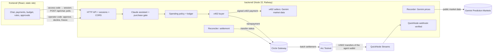

# Allowance

A voice AI agent with a spending allowance. You ask about a prediction market, and the agent pays for the data it needs one request at a time in USDC on **Arc Testnet**, through **Circle Gateway nanopayments (x402)**. It stays inside rules you set:
- a seller allowlist;
- a per-request limit and a daily budget;
- a person's approval above a threshold;
- a freeze switch.

UBC 2026 hackathon entry (Agentic Payments and AI track), built on Gemini Prediction Markets data, QuickNode Streams, ElevenLabs and Claude.

**Testnet only.** All money is testnet USDC. No secret belongs in this repository or in the frontend build.

[](https://youtu.be/b4DCkSpXMfM)

## Submission links

| What | Link |
|---|---|
| Demo video | **https://youtu.be/b4DCkSpXMfM** |
| Live demo (Netlify) | **https://allowance-ubc-2026.netlify.app**: the demo is at [`/#/demo`](https://allowance-ubc-2026.netlify.app/#/demo) |
| Source | https://github.com/pratyushsawant/allowance-main |
| Arc Testnet explorer | https://explorer.testnet.arc.io |

### Demo access for judges

Open [the live demo](https://allowance-ubc-2026.netlify.app/#/demo) and enter the **demo access code**:

```text
-l4aTBpuSG6V
```

(It starts with a hyphen.)

- **What it allows:** an *agent* session. You can chat with the assistant, and when you ask for fresh data it may buy small items with **testnet** USDC, inside the rules below. Items up to 0.25 USDC buy automatically.
- **What it doesn't allow:** anything over 0.25 USDC (the deep brief) waits for a person. Approving, declining, freezing and unfreezing need the separate **operator code**:

  ```text
  ZT-HyhRA1Kb4
  ```

  The app asks for it only when you press Approve, Don't buy, Freeze or Unfreeze; the AI agent never sees it. Approve the 0.75 deep brief at most once, because the demo wallet holds limited testnet USDC.
- **Shared budget:** the daily cap (3.00 USDC) is shared by everyone using this code, and the team may rotate the code after judging.
- **Spending may be frozen when you visit.** The red banner says so. The assistant still chats, searches markets and explains past results, but every purchase is refused and nothing is charged until an operator unfreezes it.

## Decision loop

1. **You ask** by typing, or by voice through browser speech. The message goes to `POST /api/chat` on the backend; nothing in the browser decides to spend.
2. **Claude reasons with free tools first** (`claude-sonnet-5-5`, server-side):
   - `search_markets`: Gemini titles and outcomes, without prices;
   - `list_catalog`;
   - `check_budget`;
   - `list_purchases`;
   - `get_purchase_result`, which reuses data already bought.

   Greetings, follow-ups and explanations end here.
3. **Only an explicit request for fresh data reaches the one paid tool**, `buy_market_data`. The model can choose only the item (from 4) and a ticker it has already seen; the server supplies the seller, URL and amount.
4. **The backend's policy decides**, in order: frozen? → network and asset → seller allowlist → per-call cap → daily cap → funds → auto-approve limit. The result is allow, wait for a person, or block. An allowed purchase reserves funds atomically, with an idempotency key.
5. **Payment:** the seller answers HTTP 402. A guarded signer signs an x402 authorization only if every term matches the approved quote: payee, amount, asset, network and validity. Circle Gateway accepts it, the seller returns the data, and Claude answers from it, with timestamps.
6. **Settlement and monitoring:**
   - a reconciler marks the purchase `settled` when Circle's batch lands on Arc;
   - QuickNode Streams reports the agent wallet's USDC transfers, recording deposits and freezing spending on any unexpected outbound transfer.

## Safety limits

| Limit | Value / rule |
|---|---|
| Seller allowlist | Only the Odds Desk payee `0x3b53b70d0275e5b2f8a3DFe6Cb0d949B3D7Ea14e`. The "Shady Reports" seller `0xc0018D576887922BC9Cbc4C40B2cfB4d40Fc6329` is deliberately not allowlisted. |
| Auto-approve | Up to 0.25 USDC. Above that, a person approves with the **operator** code; the agent and Claude can't approve. |
| Per purchase / per day | 1.00 USDC / 3.00 USDC (day = America/Chicago). The daily cap was raised from 2.00 on Nov 20 so the approval demo fits the day's budget. |
| Freeze | Operator kill switch. It also trips automatically on an unexpected outbound transfer seen by QuickNode Streams. |
| Chat purchase gate | Never on "wait / stop / cancel / never mind" or a bare greeting; at most one purchase per message; ticker must be known; the same message id is never run twice |
| Payment binding | The signature is bound to the exact payee, amount, asset, network and validity; anything else is refused before signing |
| Pending payments | A timeout is never treated as a failure; funds stay held until Circle confirms |
| Keys | Server-side only: wallet keys, Anthropic and ElevenLabs keys, and the QuickNode HMAC token. The browser holds only short-lived session tokens, in memory. |

## How Allowance uses Arc, Gemini and QuickNode Streams

**Arc Testnet (chain ID `5042002`):**

| Contract / wallet | Address |
|---|---|
| USDC (ERC-20 interface, 6 decimals) | `0x3600000000000000000000000000000000000000` |
| Circle GatewayWallet | `0x0077777d7EBA4688BDeF3E311b846F25870A19B9` |
| Circle GatewayMinter | `0x0022222ABE238Cc2C7Bb1f21003F0a260052475B` |
| Agent (payer) wallet | `0xE5EDEC99DcF041E022E7A843d00b37fb49d08fbd` |
| Odds Desk seller (allowlisted) | `0x3b53b70d0275e5b2f8a3DFe6Cb0d949B3D7Ea14e` |
| Shady Reports seller (not allowlisted) | `0xc0018D576887922BC9Cbc4C40B2cfB4d40Fc6329` |

The agent deposits testnet USDC into Circle Gateway. It pays each data request with an x402 nanopayment (Gateway batch settlement on Arc) and reads its Gateway balance for the budget.

**Gemini Prediction Markets API:** `GET https://api.gemini.com/v1/prediction-markets/events?status=active&limit&offset`. A recorder polls every minute and stores prices on change, plus a 15-minute heartbeat. Snapshots, odds history and the deep brief are computed only from those recorded prices; the deep brief reports "insufficient history" rather than inventing movement. No trading.

**QuickNode Streams:**
- **Network and dataset:** Arc Testnet, receipts/logs.
- **Filter:** `backend/streams/filter.js` keeps native USDC `Transfer` logs (emitter `0xff…fe`) that touch the agent wallet.
- **Destination:** a webhook, `POST /webhooks/quicknode` on Railway. It checks the HMAC-SHA256 signature over nonce + timestamp + body, a 5-minute freshness window and a nonce replay guard, then de-duplicates and classifies each transfer: top-up, Gateway deposit or withdrawal, or unexpected outbound (which freezes spending).
- **Why:** it gives onchain proof that funds moved, independent of the payment SDK.

**ElevenLabs (live):** ElevenLabs Agents through `@elevenlabs/react` (WebRTC voice), with agent `agent_4701m7x0rvw0fresesyaat3sdjpd`.
- **Authentication:** enabled on the agent. The backend mints a conversation token per session (`POST /api/voice/session`), so the ElevenLabs API key never reaches the browser.
- **One client tool, `ask_allowance`:** it sends the person's spoken words to the same Claude conversation as the chat panel (`POST /api/chat`). Spoken requests therefore pass the same purchase gate, spending policy and approval popup as typed ones. The agent then speaks Claude's answer.
- **Where to use it:** tap the mic on `/#/demo` in Chrome or Edge; the browser asks for microphone access.
- **Verified live (17:42 UTC), without a microphone, over a text-mode session:**
  - the agent called `ask_allowance` with the user's words;
  - Claude answered through the backend;
  - the agent spoke the answer (audio received);
  - no purchase was made.

## Architecture



- **One way to buy:** the server-side assistant (`claude-sonnet-5-5`) can *ask* to buy, at most once per message, never on "wait", "stop" or a greeting. A resent message never runs twice.
- **Server policy decides every purchase:** allowlisted payee from the seller's real 402 quote, per-call cap, daily cap, freeze, and an approval threshold.
- **Approval is operator-only:** above the auto-approve limit, a purchase waits for a person with the **operator** code. The assistant has no approve tool.
- **The ledger never double-charges** (idempotency keys, reservations) and tracks `accepted` (paid) separately from `settled` (onchain tx).
- **QuickNode Streams** reports the agent wallet's onchain transfers. Any unexpected outbound transfer freezes spending.
- **The browser never calls the purchase endpoint**, never holds a backend secret, and keeps session tokens in memory only.

Details: [docs/ARCHITECTURE.md](docs/ARCHITECTURE.md).

## Repository layout

| Path | What |
|---|---|
| [`backend/`](backend/) | API, assistant, policy, ledger, x402 buyer and sellers, recorder, reconciler, QuickNode webhook. Tests: `src/*.test.ts`. Docker build for Railway. |
| [`frontend/`](frontend/) | Vite + React + TypeScript + Tailwind. Landing page, live demo (`#/demo`), markets page (`#/markets`). |
| [`docs/`](docs/) | Status, deployment runbook, frontend contract, API examples, architecture, voice setup. |
| [`netlify.toml`](netlify.toml) | Frontend hosting config (`base = "frontend"`). |

## Local setup

Requires **Node 22** (`backend/.nvmrc`).

**Backend** ([backend/README.md](backend/README.md)):
```bash
cd backend
nvm use && npm ci
npm run typecheck && npm test          # 72 tests
npm run keys:generate                  # creates backend/.env with fresh TESTNET keys (never committed)
npm start                              # http://127.0.0.1:8787
```
Don't run a local spending backend while the Railway one uses the same buyer key.

**Frontend** ([frontend/README.md](frontend/README.md)):
```bash
cd frontend
npm ci
npm run dev                            # http://localhost:5173, talks to the live Railway backend
VITE_API_URL=http://127.0.0.1:8787 npm run dev   # or a local backend
VITE_USE_MOCK=1 npm run dev            # offline demo with fake data, clearly labelled
```
The demo asks for the **demo access code**. Approve, Decline, Freeze and Unfreeze ask for the **operator code**. Both codes are backend configuration and are never stored in the frontend.

## Environment variables (names only)

Full annotated lists: [`backend/.env.example`](backend/.env.example) and [`frontend/.env.example`](frontend/.env.example). Real values live only in `backend/.env` (gitignored) and in Railway's variables.

| Group | Backend variables |
|---|---|
| Wallets (testnet) | `BUYER_PRIVATE_KEY`; `SELLER_ADDRESS`, `UNLISTED_SELLER_ADDRESS` (seller private keys are for local smoke tests only) |
| Access | `AGENT_API_TOKEN`, `OPERATOR_API_TOKEN`, `SESSION_SECRET`, `DEMO_ACCESS_CODE`, `OPERATOR_ACCESS_CODE`, `AGENT_SESSION_TTL_SECONDS`, `OPERATOR_SESSION_TTL_SECONDS`, `AUTH_VERSION` |
| Spending policy | `AUTO_APPROVE_MAX_USDC` (0.25), `PER_CALL_MAX_USDC` (1.00), `DAILY_CAP_USDC` (code default 2.00; the live deployment uses 3.00), `BUDGET_TIME_ZONE` (America/Chicago), `ALLOWED_PAYEES` (optional) |
| Assistant | `ANTHROPIC_API_KEY`, `ANTHROPIC_MODEL` |
| Voice | `ELEVENLABS_API_KEY`, `ELEVENLABS_AGENT_ID`, `ELEVENLABS_API_BASE` |
| Chain | `GATEWAY_API_URL`, `ARC_RPC_URL`, `QN_STREAM_SECURITY_TOKEN` |
| Service | `HOST`, `PORT`, `PUBLIC_BASE_URL`, `CORS_ALLOWED_ORIGINS`, `DB_PATH`, `RECORDER_ENABLED`, `SELLER_PORT` |
| Smoke scripts | `SMOKE_PRICE_USDC`, `DEPOSIT_USDC`, `EXPECTED_PRICE_USDC`, `SMOKE_ORIGIN`, `SMOKE_QUERY`, `SIMULATE_BASE_URL` |

Frontend: `VITE_API_URL` (defaults to the Railway URL) and `VITE_USE_MOCK`. Both are public.

## Deployments (separate)

| Part | Where | How |
|---|---|---|
| Backend | Railway: `https://allowance-backend-production.up.railway.app` | `railway up` from `backend/` (Dockerfile, volume at `/data`). If connected to GitHub: Root Directory `/backend`. |
| Frontend | Netlify: `https://allowance-ubc-2026.netlify.app` | The root `netlify.toml` builds `frontend/` (base `frontend`, `npm ci && npm run build`, publish `dist`, Node 22, SPA fallback, `/api/yahoo` proxy). Deployed with `netlify deploy --prod --no-build --dir frontend/dist` after `npm run build` in `frontend/`. The site's exact origin is in `CORS_ALLOWED_ORIGINS` on Railway. |

Step by step: [docs/DEPLOY.md §6](docs/DEPLOY.md#6-combined-repository-and-frontend-hosting). Live status and verification log: [docs/BACKEND_STATUS.md](docs/BACKEND_STATUS.md).

## Demo flow

On `#/demo`, enter the demo access code, then:

1. **"Hi! What can you do?"** → a normal answer, with nothing bought. "Wait" and "stop" never buy.
2. **"What are the odds for Minnesota vs Oklahoma State?"** → one 0.005 USDC snapshot, auto-approved. The payment shows **Paid · settling on Arc**, then **Settled on Arc** with the Arc tx a few minutes later. **"Explain that"** reuses the result without buying again.
3. **"Get me a deep brief on that game"** → 0.75 USDC is over the 0.25 limit, so the approval popup opens. **Approve** with the operator code, and the assistant explains the brief.
4. **"Get me the full report"** → refused, because that seller isn't on the allowlist. It shows as **Not charged** with the reason.
5. **Rules → Freeze all spending** (operator code) → the banner appears on every view and purchases are refused → **Unfreeze**.
6. **Payments → Onchain activity** → the agent wallet's Gateway deposit, as delivered by QuickNode Streams.

A full run commits about 0.78 USDC of the 3.00 USDC daily cap, which resets at midnight America/Chicago. Check [BACKEND_STATUS.md](docs/BACKEND_STATUS.md) for today's remaining budget and whether spending is frozen before recording.

## Verified live (2026-11-20, 17:05–17:10 UTC, spending frozen)

**Against the deployed site and backend, nothing bought:**
- the Netlify landing page and `#/demo` load with no console errors;
- a wrong access code typed into the deployed page is refused by the live backend, which proves browser → Railway including CORS;
- CORS preflight from the Netlify origin returns 204 (an unlisted origin gets 403);
- demo-code login (`POST /api/sessions` with the Netlify origin) returns an agent session;
- with that session:
  - a real Claude (`claude-sonnet-5-5`) conversation that remembered a name and a market across turns;
  - the budget shows frozen, 1.53 of 2.00 USDC used (the cap at that time; it was raised to 3.00 at 17:18 UTC);
  - the ledger lists the real settled, blocked and declined purchases;
  - no purchase was made.

**Earlier the same day, live with approval:** paid x402 purchases on Arc Testnet, including a 0.005 snapshot and a 0.75 deep brief approved by the operator through chat. Both settled onchain. Details: [docs/BACKEND_STATUS.md](docs/BACKEND_STATUS.md).

**With a local mock backend only (not live):** the approval popup, approve-while-frozen, approve and decline in the UI, and the rendering of every ledger state.

**Not verified in a browser by us after deploy:** the logged-in UI on Netlify. The login was checked through the same API calls the page makes.

## Known gaps

- **Voice needs a microphone and Chrome or Edge.** Our automated check used a text-mode ElevenLabs session, so live mic input in the deployed page still needs a person to try it. Without a mic, typing works the same way.
- **Markets page prices:** the free Yahoo Finance charts come through Netlify's proxy, and Yahoo may answer `429` (rate limit) to Netlify's servers. CoinGecko and Polymarket data and the paid Gemini data through the assistant are unaffected.
- **The Netlify site isn't connected to GitHub:** it was deployed from the CLI. Redeploy after changes, or link the repository in Netlify (base `frontend` is already in `netlify.toml`).
- **The demo endpoint still accepts browser sessions:** `POST /api/purchases` accepts agent sessions as well as the server credential. The bundled frontend never uses it; restricting it is proposed in [BACKEND_STATUS.md](docs/BACKEND_STATUS.md#stale-browser-tabs).
- **Top-ups aren't spendable automatically:** a top-up to the agent wallet is recorded but not moved into Gateway on its own.
