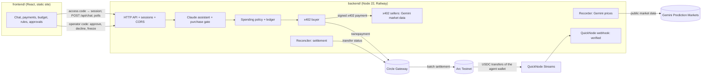

# Allowance

A voice AI agent with a spending allowance. You ask about a prediction market, and the agent pays for the data it needs one request at a time in USDC on **Arc Testnet**, through **Circle Gateway nanopayments (x402)**. It stays inside rules you set:
- a seller allowlist;
- a per-request limit and a daily budget;
- a person's approval above a threshold;
- a freeze switch.

UBC 2026 hackathon entry (Agentic Payments and AI track), built on Gemini Prediction Markets data, QuickNode Streams, ElevenLabs and Claude.

**Testnet only.** All money is testnet USDC. No secret belongs in this repository or in the frontend build.

## Architecture



- **One way to buy:** the server-side assistant (`claude-sonnet-5-5`) can *ask* to buy, at most once per message, never on "wait", "stop" or a greeting. A resent message never runs twice.
- **Server policy decides every purchase:** allowlisted payee from the seller's real 402 quote, per-call cap, daily cap, freeze, and an approval threshold.
- **Approval is operator-only:** above the auto-approve limit, a purchase waits for a person with the **operator** code. The assistant has no approve tool.
- **The ledger never double-charges** (idempotency keys, reservations) and tracks `accepted` (paid) separately from `settled` (onchain tx).
- **QuickNode Streams** reports the agent wallet's onchain transfers. Any unexpected outbound transfer freezes spending.
- **The browser never calls the purchase endpoint**, never holds a backend secret, and keeps session tokens in memory only.

Details: [docs/ARCHITECTURE.md](docs/ARCHITECTURE.md).

## Repository layout

| Path | What |
|---|---|
| [`backend/`](backend/) | API, assistant, policy, ledger, x402 buyer and sellers, recorder, reconciler, QuickNode webhook. Tests: `src/*.test.ts`. Docker build for Railway. |
| [`frontend/`](frontend/) | Vite + React + TypeScript + Tailwind. Landing page, live demo (`#/demo`), markets page (`#/markets`). |
| [`docs/`](docs/) | Status, deployment runbook, frontend contract, API examples, architecture, voice setup. |
| [`netlify.toml`](netlify.toml) | Frontend hosting config (`base = "frontend"`). |

## Local setup

Requires **Node 22** (`backend/.nvmrc`).

**Backend** ([backend/README.md](backend/README.md)):
```bash
cd backend
nvm use && npm ci
npm run typecheck && npm test          # 72 tests
npm run keys:generate                  # creates backend/.env with fresh TESTNET keys (never committed)
npm start                              # http://127.0.0.1:8787
```
Don't run a local spending backend while the Railway one uses the same buyer key.

**Frontend** ([frontend/README.md](frontend/README.md)):
```bash
cd frontend
npm ci
npm run dev                            # http://localhost:5173, talks to the live Railway backend
VITE_API_URL=http://127.0.0.1:8787 npm run dev   # or a local backend
VITE_USE_MOCK=1 npm run dev            # offline demo with fake data, clearly labelled
```
The demo asks for the **demo access code**. Approve, Decline, Freeze and Unfreeze ask for the **operator code**. Both codes are backend configuration and are never stored in the frontend.

## Environment variables (names only)

Full annotated lists: [`backend/.env.example`](backend/.env.example) and [`frontend/.env.example`](frontend/.env.example). Real values live only in `backend/.env` (gitignored) and in Railway's variables.

| Group | Backend variables |
|---|---|
| Wallets (testnet) | `BUYER_PRIVATE_KEY`; `SELLER_ADDRESS`, `UNLISTED_SELLER_ADDRESS` (seller private keys are for local smoke tests only) |
| Access | `AGENT_API_TOKEN`, `OPERATOR_API_TOKEN`, `SESSION_SECRET`, `DEMO_ACCESS_CODE`, `OPERATOR_ACCESS_CODE`, `AGENT_SESSION_TTL_SECONDS`, `OPERATOR_SESSION_TTL_SECONDS`, `AUTH_VERSION` |
| Spending policy | `AUTO_APPROVE_MAX_USDC` (0.25), `PER_CALL_MAX_USDC` (1.00), `DAILY_CAP_USDC` (2.00), `BUDGET_TIME_ZONE` (America/Chicago), `ALLOWED_PAYEES` (optional) |
| Assistant | `ANTHROPIC_API_KEY`, `ANTHROPIC_MODEL` |
| Voice | `ELEVENLABS_API_KEY`, `ELEVENLABS_AGENT_ID`, `ELEVENLABS_API_BASE` |
| Chain | `GATEWAY_API_URL`, `ARC_RPC_URL`, `QN_STREAM_SECURITY_TOKEN` |
| Service | `HOST`, `PORT`, `PUBLIC_BASE_URL`, `CORS_ALLOWED_ORIGINS`, `DB_PATH`, `RECORDER_ENABLED`, `SELLER_PORT` |
| Smoke scripts | `SMOKE_PRICE_USDC`, `DEPOSIT_USDC`, `EXPECTED_PRICE_USDC`, `SMOKE_ORIGIN`, `SMOKE_QUERY`, `SIMULATE_BASE_URL` |

Frontend: `VITE_API_URL` (defaults to the Railway URL) and `VITE_USE_MOCK`. Both are public.

## Deployments (separate)

| Part | Where | How |
|---|---|---|
| Backend | Railway: `https://allowance-backend-production.up.railway.app` | `railway up` from `backend/` (Dockerfile, volume at `/data`). If connected to GitHub: Root Directory `/backend`. |
| Frontend | Netlify (not deployed yet) | Import the repository; the root `netlify.toml` builds `frontend/`. Then add the site's exact origin to `CORS_ALLOWED_ORIGINS` on Railway. |

Step by step: [docs/DEPLOY.md §6](docs/DEPLOY.md#6-combined-repository-and-frontend-hosting). Live status and verification log: [docs/BACKEND_STATUS.md](docs/BACKEND_STATUS.md).

## Demo flow

On `#/demo`, enter the demo access code, then:

1. **"Hi! What can you do?"** → a normal answer, with nothing bought. "Wait" and "stop" never buy.
2. **"What are the odds for Minnesota vs Oklahoma State?"** → one 0.005 USDC snapshot, auto-approved. The payment shows **Paid · settling on Arc**, then **Settled on Arc** with the Arc tx a few minutes later. **"Explain that"** reuses the result without buying again.
3. **"Get me a deep brief on that game"** → 0.75 USDC is over the 0.25 limit, so the approval popup opens. **Approve** with the operator code, and the assistant explains the brief.
4. **"Get me the full report"** → refused, because that seller isn't on the allowlist. It shows as **Not charged** with the reason.
5. **Rules → Freeze all spending** (operator code) → the banner appears on every view and purchases are refused → **Unfreeze**.
6. **Payments → Onchain activity** → the agent wallet's Gateway deposit, as delivered by QuickNode Streams.

A full run commits about 0.78 USDC of the 2.00 USDC daily cap, which resets at midnight America/Chicago. Check [BACKEND_STATUS.md](docs/BACKEND_STATUS.md) for today's remaining budget and whether spending is frozen before recording.

## Known gaps

- **ElevenLabs voice isn't configured** on the backend yet ([docs/VOICE_INTEGRATION.md](docs/VOICE_INTEGRATION.md)). The app falls back to browser speech in Chrome and Edge, and to typing elsewhere.
- **The frontend isn't hosted yet**, and its origin isn't yet in CORS.
- **The demo endpoint still accepts browser sessions:** `POST /api/purchases` accepts agent sessions as well as the server credential. The bundled frontend never uses it; restricting it is proposed in [BACKEND_STATUS.md](docs/BACKEND_STATUS.md#stale-browser-tabs).
- **Top-ups aren't spendable automatically:** a top-up to the agent wallet is recorded but not moved into Gateway on its own.
