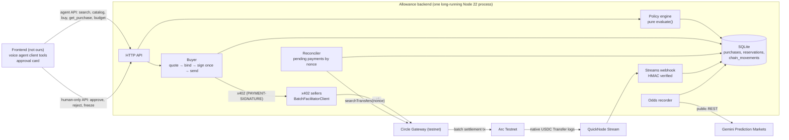

# Allowance backend architecture

As of 2026-11-20 (Phase 0 complete). Scope: **backend only**. Product context: [PROJECT_BRIEF.md](../PROJECT_BRIEF.md).

Phase 0 proved the payment rail end to end on **Arc Testnet**: a 0.005 USDC Circle Gateway nanopayment was signed under terms the buyer approved, accepted by Gateway, and delivered by the seller. The spending authorization is bound to the exact payee, amount, asset, network, contract and validity window before the key signs.

Phase 1 (section 7) added the standalone service:
- the Gemini odds recorder;
- the spending policy;
- the budget-reserving ledger;
- the buyer and the reconciler;
- the catalog's x402 sellers;
- the agent and operator HTTP API.

All of it was verified live on Arc Testnet. Voice, QuickNode Streams, analytics and the frontend are **not built**.

Labels used throughout: **Verified** (observed in this repo's runs or read in official docs/SDK source today), **Assumption** (not yet checked), **Mock** (stand-in used only for the smoke test), **Blocker** (prevents a later step until resolved).

## 1. Decisions

**Decided 2026-11-20: the backend is a standalone, long-running Node 22 service.** The frontend, whatever it uses, calls it over HTTP. Reasons:
- `BatchFacilitatorClient` works without Express (**Verified** in Phase 0).
- The odds recorder needs a long-running process.
- SQLite needs a persistent disk, so serverless hosting is ruled out.

Express is **not** adopted. Allowance settles through `BatchFacilitatorClient` with its own term checks, not through Circle's Express-only `createGatewayMiddleware`. The HTTP layer stays plain `node:http`, as in Phase 0, unless a different router is approved.

Still waiting on approval:

| Decision | Facts | Options |
|---|---|---|
| What "budget" means | The brief uses it for the $2/day cap, the Gateway balance, and "top-ups raise the budget". | Proposed: two numbers. Daily cap (policy) and available funds (Gateway `available`). Top-ups raise available funds only. |
| Hosting and public URL | QuickNode webhooks and the Devpost demo link need public HTTPS. No tunnel tool is installed. | Railway/Render with a volume, or local + tunnel for the demo. |
| Repository remote | `Allowance Project/` is now its own git repo (no commits). | Create the public GitHub repo when ready; nothing has been committed or pushed. |

## 2. Component architecture



Built so far:
- **Phase 0:** term binding and the guarded signer (`src/x402.ts`), units, config, smoke-test scripts.
- **Phase 1:** everything in the diagram except the Streams webhook (section 7).

## 3. Payment security design

### 3.1 What a Gateway nanopayment signature binds

Read from `@circle-fin/x402-batching@4.0.0` source (`BatchEvmScheme.signAuthorization`) and confirmed against the live Gateway `GET /v1/x402/supported` response.

| Term | Covered by the signature? | How Allowance enforces it |
|---|---|---|
| Payee | Yes: EIP-712 message `to` | Must equal the approved seller in the 402 offer, in the typed data at signing time, and in the produced payload. Gateway also rejects `address_mismatch`. |
| Amount | Yes: message `value` (base units) | Same three checks; Gateway rejects `amount_mismatch`. |
| Network | Yes: domain `chainId` | Must be `5042002` / `eip155:5042002`. |
| Gateway Wallet | Yes: domain `verifyingContract` | Must equal the SDK constant, which the seller also cross-checks against live Gateway. |
| Asset | Version "2": domain `salt` = asset. Version "1": **not signed**, but Gateway accepts v1 for USDC only. | Offer asset must match. For v2 the guard requires `salt` = padded USDC address. Phase 0 seller advertises v2. |
| Expiration | Yes: `validAfter` / `validBefore` | Live Gateway minimum is 604,800 s (7 days); SDK signs 604,900 s. The guard refuses windows outside [604,800, 604,960] s. **A signed authorization is spendable for ~7 days and cannot be shortened.** |
| Replay | Yes: random 32-byte `nonce` | One nonce per purchase. Gateway rejects `nonce_already_used`. |
| Resource URL | **No** | The buyer only sends the signature to the approved URL. The seller refuses a payload whose `resource.url` is not its own. |
| Payer | Yes: `from` + signature | The guard refuses a signer that isn't the approved payer. |

Flow in `backend/src/x402.ts`:

1. `selectApprovedOption()` takes the decoded 402 and requires exactly one Gateway option. Every term in it must match the approval; a mismatch throws `TermsMismatchError` and nothing is signed.
2. `createGuardedSigner()` is the only signer handed to the SDK's `BatchEvmScheme`. At signing time it re-checks the full EIP-712 domain and message against the approval, and it signs at most once.
3. `assertAuthorizationMatches()` re-checks the produced payload before it leaves the process.

**`GatewayClient.pay(url)` is not used.** It re-runs the 402 negotiation itself and accepts only `method`, `body` and `headers` (SDK type definitions), so it cannot be capped or pinned to a quote.

### 3.2 Budget reservation, idempotency and concurrency (implemented in Phase 1; see section 7 for the shipped states)

Storage is SQLite in WAL mode, with every money-moving step inside `BEGIN IMMEDIATE`, which takes the single write lock. Amounts are stored as `INTEGER` base units of the asset's ERC-20 decimals; USDC at 6 decimals fits SQLite's 64-bit range up to about 9.2 trillion USDC. They are read back as `BigInt` (`safeIntegers`). Arc's 18-decimal native amounts never go into these columns. They are converted with `rescaleExact()`, which throws instead of truncating, or kept as text in the chain ledger.

```sql
CREATE TABLE purchases (
  id               TEXT PRIMARY KEY,
  idempotency_key  TEXT NOT NULL UNIQUE,      -- tool-call id / UI request id
  resource_url     TEXT NOT NULL,
  pay_to           TEXT NOT NULL,
  asset            TEXT NOT NULL,
  network          TEXT NOT NULL,
  amount           INTEGER NOT NULL CHECK (amount > 0),   -- base units
  state            TEXT NOT NULL CHECK (state IN (
                     'blocked','awaiting_approval','reserved','signed',
                     'accepted','settled','rejected','pending_unknown','expired')),
  nonce            TEXT UNIQUE,
  valid_before     INTEGER,
  gateway_transfer TEXT UNIQUE,
  settlement_tx    TEXT,
  reason           TEXT,
  created_at       INTEGER NOT NULL,
  updated_at       INTEGER NOT NULL
);
-- Money committed today = SUM(amount) WHERE state IN
--   ('reserved','signed','accepted','settled','pending_unknown') AND day = today (America/Chicago).
```

**Reserving budget.** In one `BEGIN IMMEDIATE` transaction:
1. Look up the idempotency key. If it exists, return the stored row: a retried tool call never pays twice.
2. Check, in order: freeze, allowlist, per-call cap, then `committed_today + amount <= daily cap` and `amount <= Gateway available − committed_unsettled`.
3. Insert the row as `reserved`, or as `awaiting_approval` / `blocked`.

**Approving.** A human approval runs the same transaction again (the limits or the freeze may have changed) before moving `awaiting_approval` to `reserved`.

**Signing and sending.** These happen only from `reserved`:
1. Fetch the quote and bind it with `selectApprovedOption`, using the reserved row's terms.
2. Sign through the guarded signer.
3. Write `nonce`, `valid_before` and `state='signed'` **before** the request leaves the process. This is the write-ahead step.
4. Send, then record the outcome.

**Concurrency.** One backend process, and SQLite's write lock serializes reservations. Each approval gets a fresh single-use guarded signer. If the backend ever runs as several processes, the SQLite file lock still serializes. With Postgres, use `SERIALIZABLE` or lock a per-day budget row.

### 3.3 Unresolved payments stay pending

| Signal | State | Reservation |
|---|---|---|
| 2xx from seller (Gateway accepted) | `accepted` | Kept: counts as spent |
| Gateway transfer `completed` with `txHash` | `settled` | Kept |
| Seller 402 with a Gateway reason that makes the authorization permanently invalid (`invalid_signature`, `amount_mismatch`, `address_mismatch`, `authorization_expired`, `unsupported_*`, `invalid_payload`, `self_transfer`) | `rejected` | Released |
| Seller 402 with any other reason, e.g. `insufficient_balance`. The signed authorization could still settle later if funds arrive, because it stays valid ~7 days. | `pending_unknown` | **Kept** |
| Timeout, 5xx, network error, seller `settlement_status_unknown` | `pending_unknown` | **Kept** |
| `pending_unknown`, `searchTransfers({nonce})` finds a transfer | `accepted` / `settled` | Kept |
| `pending_unknown`, nothing found **and** `now > valid_before + margin` | `expired` | Released (the authorization can no longer settle) |

A timeout is never treated as failure. The authorization stays valid for about 7 days, so a reconciler polls Gateway by nonce. The seller side follows the same rule: on an unknown settle outcome it does not deliver (Phase 0 `seller.ts`). The SDK's Circle Facilitator path defines `settlement_pending` with the same instruction: "The seller must not deliver".

### 3.4 Units and decimals

| Representation | Decimals | Source | Status |
|---|---|---|---|
| Arc native USDC (gas, `eth_getBalance`, EIP-7708 Transfer logs) | 18 | SDK `chain.nativeCurrency`, Arc docs | **Verified** (balance read: raw `20000000000000000000` = 20 USDC) |
| USDC ERC-20 interface `0x3600…0000` | 6 | `decimals()` read onchain on every script run | **Verified** (raw `20000000` = 20 USDC, same balance) |
| x402 `amount` and Gateway balances (SDK `bigint`) | 6 (USDC base units) | Live 402 (`"5000"` = 0.005), live Gateway supported assets (`decimals: 6`) | **Verified** |
| `GatewayClient.deposit()` / `withdraw()` input | decimal string | SDK reference | **Verified** |
| Gateway REST `/v1/balances` | decimal string | Buyer quickstart code | Documented, not used directly |

Rules:
- Use `bigint` everywhere, with decimals passed explicitly and confirmed onchain at startup.
- `toBaseUnits()` refuses extra precision, and `rescaleExact()` throws instead of truncating.
- Never use `parseFloat`. Arc's docs warn that crediting from the 6-decimal view truncates.

### 3.5 Webhook security (QuickNode Streams, not built yet)

- **Arc Testnet support (Verified):** QuickNode's supported-chains table lists Arc Testnet with the Logs dataset (Validator Activity is not supported).
- **Authentication (Verified, docs):** each delivery carries `X-QN-Nonce`, `X-QN-Timestamp` and `X-QN-Signature`. The signature is HMAC-SHA256 over `nonce + timestamp + payload`, keyed with the Stream's **security token**. For gzip deliveries, the payload is the decompressed JSON string.
- **Verification:** read the raw body, recompute the HMAC, and compare with `timingSafeEqual`.
- **Freshness:** reject timestamps outside ±5 minutes and nonces already seen in that window (QuickNode recommends timestamp checks).
- **Secret storage:** the token lives in `QN_STREAM_SECURITY_TOKEN` in `.env`, **never in the URL**.
- **Unverified deliveries** get `401` and change nothing.
- **Verified events** only write to the chain ledger, deduplicated on `chainId:txHash:logIndex`. A top-up raises available funds only after the transfer is also confirmed by an RPC receipt read. An unexpected outbound transfer freezes the agent; no webhook event can unfreeze it.
- **Acknowledgement:** reply 2xx only after the database commit. A non-2xx response makes Streams retry, then pause.
- **Filter:** native emitter `0xffff…fffe`, 18 decimals; skip the `0x3600…` mirror, which double-counts.
- **Assumption:** the testnet network slug and filter test blocks. QuickNode's Arc guide uses Arc **Mainnet** (`CHAIN_ID '5042'`, test block 19051680). Testnet values must be confirmed in the Streams dashboard.
- **Verified (section 4.1):** batch settlement emits no USDC Transfer logs, so a Transfer-log Stream sees the agent's deposits, top-ups, withdrawals and anomalies, never nanopayments. Payment status comes from Gateway's transfer API.

### 3.6 Secrets

- `backend/.env` is mode 600 and matched by `.gitignore` (verified with `git check-ignore`).
- `npm run keys:generate` never overwrites an existing file and prints addresses only.
- The scripts never print private keys or payment signatures.
- Run logs in `backend/.smoke/` (gitignored) hold public identifiers only.
- `config.ts` refuses Circle's mainnet Gateway host. `BatchFacilitatorClient` defaults to that mainnet host when no URL is given (**Verified**).

## 4. Phase 0 verification log (2026-11-20, CST)

| Check | Result | Evidence |
|---|---|---|
| Node version | Node **22.23.5** via nvm, pinned by `backend/.nvmrc`. Global default left at 20.19.5. | Circle quickstarts require Node 22.18+. |
| SDK | `@circle-fin/x402-batching@4.0.0`, `@x402/core@2.30.0`, `@x402/evm@2.30.0`, `viem@2.57.16`, all pinned exact. `npm audit`: 0 vulnerabilities. | `backend/package-lock.json` |
| SDK vs docs drift | v4 `CHAIN_CONFIGS` exposes `tokens.USDC.{address,decimals}`, not the `config.usdc` shown in the docs. v4 adds authorization version "2" (asset in salt). | SDK type definitions |
| Live Gateway (testnet) | Arc Testnet: `GatewayWalletBatched` v1 default, Gateway Wallet `0x0077777d7EBA4688BDeF3E311b846F25870A19B9`, USDC decimals 6 with auth versions ["1","2"], `minValiditySeconds` **604800**. This is stricter than the "< 3 days" error text in the SDK reference. | `GET https://gateway-api-testnet.circle.com/v1/x402/supported` |
| Wallet requirements | EOA required (smart-contract accounts rejected). Phase 0 uses a locally generated EOA. | Buyer quickstart |
| Funding | Circle faucet sent **20 USDC** to the buyer (the user submitted the form). Native and ERC-20 views both show 20. | `npm run smoke:balance` |
| Deposit (onchain) | approve `0xb9428b368b23fa5ddafb9ca8e282b12fdb83eec5aa7fc1cd6282c0faef9cda58`, deposit `0x3e0c1e01965e569b4ab66d051247bf308dc1aab11d239e2dcac7168c52fa3085` (block 73167978, success). Gateway credited 1 USDC **6 s** after submit. | [deposit tx](https://explorer.testnet.arc.io/tx/0x3e0c1e01965e569b4ab66d051247bf308dc1aab11d239e2dcac7168c52fa3085) |
| Nanopayment | 0.005 USDC (5000 base units), auth version 2, nonce `0x09bb4281567f0bb667d33d3f463aed2be4d2397f5d878190823387231a8e066a`, valid until 2026-11-27T09:41:38Z. Gateway transfer **`129cc325-b622-4915-8128-425a03c0d5b4`**, status `received`, `txHash` null. Seller delivered (HTTP 200). Buyer Gateway available went 1 → 0.995 immediately. | `npm run smoke:buy`, `.smoke/payments.jsonl` |
| Settlement | `received` → `batched` → `completed` in about 10 min. One batch tx to the Gateway Wallet, `0x76d3dcab…ca9e9`, block 73169186. No USDC Transfer log. Seller credited inside Gateway. See section 4.1. | `npm run smoke:status` |
| Binding: price mismatch | Buyer approved 0.004, seller asked 0.005. **Refused before signing** (exit 3). | `EXPECTED_PRICE_USDC=0.004 npm run smoke:buy` |
| Binding: no funds | Matching terms, zero Gateway balance. Stopped before signing (exit 4). | `npm run smoke:buy` before deposit |
| Unit tests | 11/11 pass, offline. The real SDK `BatchEvmScheme` signs through the guard (v1 and v2), the signature recovers to the payer, and tampered amount or payee is refused with the key never used. | `npm test` |

### 4.1 Settlement observation

| Time (UTC) | Observation | Status |
|---|---|---|
| 09:39:58 | Seller `settle()` returned `success: true`, `transaction: 129cc325-…`. Resource delivered. No onchain transaction is created per payment. | **Verified** |
| 09:40:07 | `getTransferById` → `status=received`, `txHash=null`. | **Verified** |
| 09:42:42 | Buyer Gateway `available` 0.995 (debited at authorization). Seller Gateway `available` 0 (not credited before batch settlement). This matches Circle's documented balance model. | **Verified** |
| 09:50:01 | `status=batched`, `txHash=null` (about 10 min after acceptance). | **Verified** |
| 09:50:17 | `status=completed`, settlement tx [`0x76d3dcabe7565955a98f32def75767b0360fc9ae37fd617c912318fdad4ca9e9`](https://explorer.testnet.arc.io/tx/0x76d3dcabe7565955a98f32def75767b0360fc9ae37fd617c912318fdad4ca9e9), block 73169186, success. Sent by a Circle operator address (`0xc73e…a884`) **to the Gateway Wallet contract**. | **Verified** |
| after | The settlement tx emitted **1 log**, from the Gateway Wallet (topic0 `0x8e9878875610f80a970e0cea1889a4c7de3012c1a52ae169d9d5d3ab2c08b670`, 4 topics), and **0 native USDC Transfer logs**. Seller Gateway `available` went 0 → 0.005; seller wallet USDC stayed 0. Buyer wallet: 20 − 1 deposit − gas = 18.996926 USDC. | **Verified** |

**What this means:**
- **No per-payment transaction:** a nanopayment never produced its own onchain transaction.
- **No token movement at settlement:** the batch rebalanced Gateway's internal accounting without moving USDC between wallets.
- **Consequence for the Stream:** a QuickNode Stream on native USDC Transfer logs for our wallets will see deposits, top-ups and withdrawals, never individual nanopayments or their settlement.
- **Watching settlements onchain:** the Stream would need to follow Gateway Wallet logs (topic above), or the backend should poll Gateway's transfer API, which the reconciler does.

**Mocks:** the seller (`scripts/seller.ts`) is a local stand-in that serves a fixed JSON resource. The "approved terms" come from `.env` instead of a policy engine. Both are real x402 and real Gateway calls; only the business logic is stubbed.

## 5. Unresolved questions

1. **Hosting** and a public URL: section 1. The framework is decided: a standalone Node service.
2. **Budget semantics** and **top-up source**. A funder wallet is suggested, because the faucet is a manual web form.
3. **Deep-brief content**: computed from data, or written by an LLM?
4. **Approval resume path**: add a `get_purchase` tool; approval expiry, rejection, and freeze while pending.
5. **QuickNode testnet specifics**: network slug, test blocks, and whether a webhook-only Stream is available on the hackathon credits.
6. **Gemini** rate limits and data terms: not stated on the market-data page.
7. **ElevenLabs** server endpoint for minting conversation tokens (exact REST path not verified), and the `textOnly` option name.
8. **Seller-side reconciliation**: the Circle seller-reconciliation how-to was not read in Phase 0.
9. **Authorization version**: v2 worked for USDC. If a third-party seller offers only v1, the asset is bound by Gateway's USDC-only rule rather than by the signature.
10. ~~Operator credential in the frontend.~~ **Resolved in Phase 2 (section 8):**
    - People log in with access codes and get short-lived scoped sessions, so the frontend never holds the static tokens.
    - Only an operator session can approve, decline, freeze or unfreeze.
    - Client tools use the agent session only.
11. **Flat history overnight.** The recorder writes on change plus a 15-minute heartbeat. Many events barely move between 4 and 8 AM, so pick a liquid event for the chart demo.
12. **CORS** is configured as an exact-origin allowlist (Phase 2). Failed logins are rate-limited. Other routes have **no general rate limit** yet, and the API stays bound to 127.0.0.1 until hosting is decided.
13. **The daily cap applies to rehearsals.** Every `api:smoke` run commits $0.775 against the real $2.00 cap.
    - Raise `DAILY_CAP_USDC` for rehearsal, or rehearse the day before.
    - Keep enough Gateway balance for the demo: funds are checked before the approval threshold, so an underfunded $0.75 brief shows up as `blocked`, not `awaiting_approval`.

## 6. Sources (official, opened 2026-11-20)

- Circle: [Nanopayments seller quickstart](https://developers.circle.com/gateway/nanopayments/quickstarts/seller.md) · [buyer quickstart](https://developers.circle.com/gateway-nanopayments/quickstarts/buyer.md) · [SDK reference](https://developers.circle.com/sdks/gateway-nanopayments-sdk.md) · [How batched settlement works](https://developers.circle.com/gateway-nanopayments/concepts/batched-settlement.md) · live `GET https://gateway-api-testnet.circle.com/v1/x402/supported`
- Arc: [EVM differences (USDC decimals, EIP-7708 events)](https://docs.arc.io/arc/references/evm-differences)
- QuickNode: [Streams supported chains](https://www.quicknode.com/docs/streams/supported-chains) · [Index every Arc USDC movement with Streams](https://www.quicknode.com/guides/arc/index-arc-usdc-movements-with-streams) · [Validate incoming Streams webhook messages](https://www.quicknode.com/guides/quicknode-products/streams/validating-incoming-streams-webhook-messages)
- Gemini: [Prediction Markets market data](https://developer.gemini.com/prediction-markets/market-data)
- ElevenLabs: [Agents React SDK](https://elevenlabs.io/docs/eleven-agents/libraries/react)
- SDK source: `backend/node_modules/@circle-fin/x402-batching` 4.0.0 (`src/client/BatchEvmScheme.ts` via source map, type definitions)

## 7. Phase 1: the standalone service (2026-11-20)

The backend runs as one Node 22 process (`npm start`) on plain `node:http`. While the standalone recorder runs in another terminal, start it with `RECORDER_ENABLED=0`.

### 7.1 Modules

| File | Responsibility |
|---|---|
| `src/server.ts` | Entry point. Checks the live Gateway, then wires the API, sellers, reconciler and (optionally) the recorder. Binds 127.0.0.1:8787 by default. |
| `src/recorder.ts`, `src/gemini.ts`, `scripts/recorder.ts` | Polls Gemini's active events every 60 s (about 1,000 events and 11,000 contracts, 4 pages of 250). Writes an odds row only on a price change, plus a 15-minute heartbeat. Prices stay exact decimal strings. Backs off on 429/5xx and honors `Retry-After`. |
| `src/policy.ts` | Pure rule order: freeze, network, asset, payee allowlist, per-call cap, daily cap (counting held amounts), available funds, then the approval threshold. Human approval lifts only the threshold. |
| `src/ledger.ts`, `src/db.ts` (migration 2) | Reserves budget inside `BEGIN IMMEDIATE`. Unique idempotency key. Every state change is checked inside a transaction. Audit trail in `purchase_events`. Freeze switch in `policy_state`. |
| `src/buyer.ts` | Quote, reserve, fresh quote that must match exactly, guarded signature, write-ahead `signed`, send, classify the outcome. |
| `src/reconciler.ts` | Every 30 s, resolves open purchases against Gateway (by transfer id or nonce). Never releases funds on a timeout alone. |
| `src/sellers.ts`, `src/catalog.ts`, `src/market-data.ts` | Odds Desk (snapshot $0.005, history $0.02, brief $0.75) and Shady Reports (full report $0.01, not allowlisted). No charge for an unknown event; no delivery when settlement is unknown. |
| `src/api.ts`, `src/http.ts` | JSON API with constant-time bearer checks and a 16 KB body limit. |

### 7.2 API

| Method and path | Token | Purpose |
|---|---|---|
| `GET /health` | none | Liveness |
| `GET /api/catalog` | agent | Items, prices, sellers |
| `GET /api/markets/search?q=` | agent | Free lookup over recorded events with their latest prices |
| `POST /api/purchases` `{item, ticker, idempotencyKey}` | agent | Request a purchase. Returns its state; `result` carries the data once paid. |
| `GET /api/purchases`, `GET /api/purchases/:id` | agent | Read purchases (the agent's `get_purchase`) |
| `GET /api/budget` | agent | Daily cap, committed, remaining, Gateway available, frozen |
| `POST /api/purchases/:id/approve`, `/decline` | **operator** | Human decision on a held purchase. Re-runs the full policy. |
| `POST /api/policy/freeze`, `/unfreeze` | **operator** | Kill switch |

The agent token is accepted on agent routes only. The operator token works everywhere.

### 7.3 Purchase states

`blocked` · `awaiting_approval` → `declined` | `approval_expired` | `reserved` → `aborted` | `signed` → `accepted` → `settled` | `needs_review`, or `rejected` | `pending_unknown` → `accepted` | `expired` | `needs_review`.

Budget is held in `reserved`, `signed`, `accepted`, `settled`, `pending_unknown` and `needs_review`.

One race remains. Gateway's available balance is read just before the reservation transaction, so it can be slightly stale. The daily cap is still exact, because it is enforced entirely in SQLite. A stale balance can at worst let Gateway refuse a payment with `insufficient_balance`, which the buyer holds as pending. It cannot cause an overspend.

### 7.4 Tests

`npm test` runs 29 offline tests.
- **units (4) and x402 binding (7):** from Phase 0.
- **recorder (4):** paging, change-only writes plus heartbeat, exact prices, failed polls recorded.
- **policy (5):** every rule, priority order, limits, approval scope.
- **purchase flow (9),** against a fake x402 seller using real signatures:
  - auto-pay;
  - approval;
  - blocked by the allowlist and by the freeze;
  - 10 concurrent $0.25 buys against the $2 cap → exactly 8 paid and 2 blocked;
  - 5 concurrent identical idempotency keys → 1 payment;
  - a hanging seller → `pending_unknown`, held until Gateway or expiry decides;
  - permanent vs transient rejections;
  - a price change after approval → aborted and unsigned;
  - the reconciler settling payments and cleaning up interrupted reservations.

### 7.5 Live run on Arc Testnet (`npm run api:smoke`, 10:00 UTC)

Event: `NCAAM-2611201730-MINN-OKST-M`, Minnesota vs Oklahoma State.

| Step | Result |
|---|---|
| Snapshot, $0.005 | `accepted`, Gateway transfer `e1b35bb2-c57a-48ab-8aac-2865de13446a`. Result: real recorded bid/ask for both contracts, plus the upsell to the unlisted report. |
| Same idempotency key again | Same purchase, same nonce. No second payment. |
| History, $0.02 | `accepted`, transfer `7933aa4d-7fc2-4146-8e48-466fbe304f6c`. Recorded since 09:49:57Z. |
| Deep brief, $0.75 | `awaiting_approval`, unsigned. Agent token approve → **401**. Operator approve → `accepted`, transfer `93c1d33a-481e-43a9-a6fb-e6fc610e785c`. |
| Full report from the unlisted seller, $0.01 | `blocked`, unsigned: "Seller 0xc001…6329 is not on the allowlist". |
| Snapshot while frozen | `blocked`, unsigned. Agent token unfreeze → **401**. |
| Budget | Committed $0.775 of $2.00. Gateway available 0.995 → **0.22** (exactly 0.995 − 0.775). |
| Settlement | The reconciler marked all three `settled` at 10:06:41Z, about 6 min after acceptance. **All three share one batch tx**, [`0x8c6314526ce6f78d37508564436ff9ce6d5ced9c4fb5522e6e8f6f8969f11081`](https://explorer.testnet.arc.io/tx/0x8c6314526ce6f78d37508564436ff9ce6d5ced9c4fb5522e6e8f6f8969f11081): block 73171076, success, sent to the Gateway Wallet, 1 log, 0 USDC Transfer logs. Seller Gateway available = 0.78 (0.005 from Phase 0 + 0.775). |

**Mocks:** the deep brief's written analysis and the full report are placeholders, flagged `mock: true` in their payloads. The related markets inside the brief are real recorded data. *(The deep-brief placeholder was replaced later the same day; see §10.)*

## 8. Phase 2: voice integration API (2026-11-20)

Backend side only; no frontend was built. The contract for whoever builds the frontend is [docs/VOICE_INTEGRATION.md](VOICE_INTEGRATION.md), and the tool definitions are in [backend/voice/client-tools.json](../backend/voice/client-tools.json).

| File | Responsibility |
|---|---|
| `src/session.ts` | Stateless session tokens: `as1.<claims>.<HMAC-SHA256>`, scope `agent` or `operator`, with expiry. Constant-time signature check. |
| `src/auth.ts` | Route scopes: agent routes accept the agent token, an agent session, or any operator credential. Operator routes accept **only** operator credentials. Also a failed-login limiter (10 per 10 min per address). |
| `src/cors.ts` | Exact-origin allowlist for `/api/*` and `/health`. Bearer tokens only, so no `Allow-Credentials`. Seller routes get no CORS headers. |
| `src/voice.ts` | Requests ElevenLabs conversation tokens (WebRTC) or signed URLs (WebSocket) server-side. The API key goes only in the `xi-api-key` header and is never returned. |
| `src/summary.ts` | One-sentence `summary` on paid purchases for the voice agent, with implied percentages computed by integer math. |
| `src/api.ts` | Adds `POST /api/sessions` and `POST /api/voice/session`, plus `summary` and clearer `next` hints on every purchase view. |

**Tests:** `npm test` passes 37/37. The 8 new tests cover:
- login and cross-scope refusal;
- that an agent session or the static agent token cannot approve, decline or unfreeze;
- expired, forged and wrong-secret tokens;
- the login rate limit;
- CORS allow and deny, including that seller routes get no CORS headers;
- voice requests (URL, header, no key leakage, 502 on an upstream error, 503 with the missing variables);
- spoken summaries.

**Live run on Arc Testnet** (`npm run voice:smoke`, 10:23 UTC; all checks passed):
- **CORS:** a preflight from `http://localhost:5173` got 204; an unlisted origin got 403.
- **Logins:** a wrong access code got 401. Agent (2 h) and operator (1 h) sessions were issued.
- **Voice:** the endpoint returned 503 `voice_not_configured`, naming `ELEVENLABS_API_KEY` and `ELEVENLABS_AGENT_ID`. This is **Blocked:** a live ElevenLabs session needs those two values in `backend/.env`.
- **Search and buy:** `search_markets` and a $0.005 snapshot with the agent session returned the summary "Minnesota vs Oklahoma State: Minnesota about 52%, Oklahoma State about 49%…".
- **First approval attempt:** the $0.75 brief was **blocked for insufficient funds**, because Gateway had $0.215. That's correct: funds are checked before the approval threshold.
- **Top-up:** after a 2 USDC Gateway deposit (approve `0x7b38bbaa…1dee02`, deposit [`0x754635df…16022`](https://explorer.testnet.arc.io/tx/0x754635df6dfc6b4cff7cbd30b2c49e8b69fe453bb82177d258b226d0edf16022), block 73173107, credited in 9 s):
  - the brief was held for approval, unsigned;
  - the agent session's approve got 401;
  - the operator session declined it, and nothing was paid.
- **Budget:** $0.785 committed today; Gateway available $2.21.

## 9. Phase 3: Streams webhook and deploy packaging (2026-11-20)

The deploy and Stream runbook is [docs/DEPLOY.md](DEPLOY.md). **Nothing is deployed and no Stream exists yet.** Both need your accounts and your go-ahead.

| File | Responsibility |
|---|---|
| `streams/filter.template.js` → `streams/filter.js` (`npm run streams:filter`) | The Quicknode filter. Keeps only native-emitter (`0xffff…fffe`, 18-decimal) USDC Transfer logs that touch the agent wallet. Emits `{movements:[{canonical_id, from, to, amount_raw, …}]}`. |
| `src/streams.ts` | `POST /webhooks/quicknode`. HMAC-SHA256 over nonce + timestamp + body with `QN_STREAM_SECURITY_TOKEN`; ±5 min freshness; nonce replay guard; gzip support. Dedupes on canonical id, classifies each movement, and freezes on an unexpected outbound. Also `GET /api/chain/movements` (agent scope). |
| `src/db.ts` migration 3 | `chain_movements` (exact raw amount, plus the 6-decimal amount only when exact) and `webhook_deliveries` |
| `backend/Dockerfile`, `.dockerignore` | Single-instance container, non-root, `/data` volume, health check, no secrets in the image |

**Classification** is relative to the agent wallet:
- **Inbound:** from the zero address or GatewayMinter → `gateway_withdrawal` (**Assumption**: no withdrawal has been observed yet); from anyone else → `top_up`.
- **Outbound:** to the Gateway Wallet → `gateway_deposit`; to anything else → `unexpected_outbound`, which **freezes** spending.

A delivery can never unfreeze, raise limits or move funds.

**Verified on real Arc Testnet data.** The filter was run against the receipts of the faucet top-up (`0xd9c7…`, 20 USDC) and both Gateway deposits. Each transaction also carries a 6-decimal mirror log from `0x3600…`, and the filter correctly drops all three mirrors.

**Deployed (2026-11-20, 10:44 UTC):**
- **URL:** `https://allowance-backend-production.up.railway.app`, on Railway as a single instance with a `/data` volume.
- **Build:** the Docker build succeeded on Railway.
- **Live checks:** `voice:smoke` passed against the live URL, including a real nanopayment made from Railway.
- **Cutover:** the local spending service is stopped.
- **Still waiting on your accounts:** the Quicknode Stream (and its `QN_STREAM_SECURITY_TOKEN`) and the ElevenLabs credentials.

Details are in [DEPLOY.md §0](DEPLOY.md).

**Quicknode end-to-end (2026-11-20, 12:05 UTC). Verified.** A real 0.5 USDC Gateway deposit (tx `0x9e99…6239`, block 73182200) reached the deployed service as a signed Quicknode delivery and was recorded **exactly once** as `gateway_deposit`.

The first attempt was dropped because the Stream sent unfiltered receipts and the receiver only read top-level `movements`. Fixed in deploy `da8d9547`:
- the receiver parses movements anywhere in a verified body;
- it applies the filter rules server-side to raw logs, with a parity test against the filter;
- it logs payload shape and warnings;
- the filter now also walks receipts.

Evidence is in [DEPLOY.md §4.2](DEPLOY.md).

## 10. Deep brief from recorded data (2026-11-20: built about 12:30 UTC, deployed 12:34 UTC as `7d400e4a`, live-verified 12:48 UTC)

`src/brief.ts` replaces the placeholder `deep_brief` result:
- **Current state:** implied probability = bid/ask midpoint, spread, leader, sum of probabilities.
- **Movement:** change, high, low and biggest move, reported **only** for contracts with 2+ recorded observations spanning 15+ minutes (one recorder heartbeat). Otherwise `status: "insufficient_history"` with a reason, and every movement field is `null`.
- **Data quality:** recorder gaps over 10 minutes and failed polls are listed in `notes`.
- **Arithmetic:** integers only.
- **Contract:** the documented fields (`mock`, `note`, `event`, `relatedMarkets`) are kept.
- **Summaries:** `summary.ts` speaks the new result, and the `odds_history` summary now distinguishes "no change" from "not enough history".
- **Tests:** `brief.test.ts`, 8 tests; 55/55 overall.
- **Real data:** see [api-examples/deep-brief-results.json](api-examples/deep-brief-results.json).

**Live check on Railway** (one purchase, authorized for at most 0.75 USDC; no retries; policy and limits unchanged):

| Step | Result |
|---|---|
| Request, 12:48:15 UTC | `awaiting_approval` ("$0.75 is over the $0.25 auto-approve limit"), 750000 base units to the allowlisted seller, unsigned |
| Operator approve, 12:48:31 | Re-quoted, checked against the held terms, signed once → **`accepted`** in 544 ms, Gateway transfer `a2c61405-87b1-439c-bd75-441850dbd86b` |
| Settlement | Batch tx [`0xa08d1c7ba089260c0e53232d7b0fa77f6b04aafe7b5d7db22a5b3ea90d71a9ca`](https://explorer.testnet.arc.io/tx/0xa08d1c7ba089260c0e53232d7b0fa77f6b04aafe7b5d7db22a5b3ea90d71a9ca), block 73191738, 13:01:01, success, sent to the Gateway Wallet. The reconciler marked it **`settled`** at 13:01:25, 12 min 54 s after acceptance. |
| Ledger | Exactly one charge. Committed $0.005 → $0.755 and Gateway available $2.705 → $1.955, both exactly 0.75. |
| Result | `mock: false`, `analysis.status: ok`, 9 observations over 123 min, no change (so `biggestMove: null`), 1 failed poll noted, 5 related events `ok` |

The captured response is [api-examples/purchase-settled-deep_brief.json](api-examples/purchase-settled-deep_brief.json).

**Follow-up fixes (deploy `315e6c55`, 2026-11-20 13:11 UTC):**
- **Percent display:** `src/percent.ts` formats every probability on its own, with at most one decimal. That's exact for cent prices and midpoints: 0.515 → "51.5%", where it used to round up to "52%". Values are never normalized to 100%; `probabilitiesSum` is the exact sum of the midpoints, so an overround shows as e.g. "102%". The brief, its summary and the snapshot summary all use it. Stored results aren't rewritten.
- **Catalog text:** `deep_brief` now reads "Analysis of one event from recorded prices: implied probabilities, spreads, and price movement where enough history has been recorded (it says when there isn't), plus related markets in the same category." Price, id and title are unchanged.
- **Tests:** 61/61. New: `percent.test.ts`, the overround case, and the catalog text.
- **Non-billable checks after the deploy:**
  - ledger, budget, stored brief and chain movements unchanged;
  - recorder resumed at poll 138;
  - seller still answers 402;
  - auth 401, voice 503, CORS 204/403 as before.
